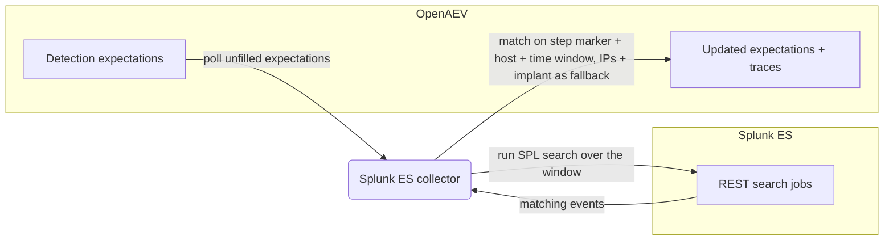

# OpenAEV Splunk Enterprise Security Collector

The Splunk Enterprise Security collector validates OpenAEV detection expectations against
[Splunk Enterprise Security](https://www.splunk.com/en_us/products/enterprise-security.html), Splunk's SIEM. After
OpenAEV agents execute attacks, the collector runs REST search jobs against Splunk ES and correlates the returned events
with the related injects to confirm whether the activity was detected.

## Table of Contents

- [OpenAEV Splunk Enterprise Security Collector](#openaev-splunk-enterprise-security-collector)
  - [Table of Contents](#table-of-contents)
  - [Introduction](#introduction)
  - [Requirements](#requirements)
  - [Configuration variables](#configuration-variables)
    - [OpenAEV environment variables](#openaev-environment-variables)
    - [Base collector environment variables](#base-collector-environment-variables)
    - [Splunk ES collector environment variables](#splunk-es-collector-environment-variables)
    - [Query template](#query-template)
  - [Deployment](#deployment)
    - [Docker Deployment](#docker-deployment)
    - [Manual Deployment](#manual-deployment)
  - [Usage](#usage)
  - [Behavior](#behavior)
    - [Query writer](#query-writer)
    - [Location memory](#location-memory)
    - [Step matching](#step-matching)
    - [Outcomes](#outcomes)
    - [Mock harness](#mock-harness)
  - [Required permissions and API endpoints](#required-permissions-and-api-endpoints)
  - [Debugging](#debugging)
  - [Additional information](#additional-information)

## Introduction

OpenAEV (Breach and Attack Simulation) raises "expectations" each time it executes an inject (a simulated attack) on an
endpoint: a DETECTION expectation (the security product should raise an alert) and/or a PREVENTION expectation (the
security product should block the action). This collector connects to Splunk Enterprise Security, registers a
`SecurityPlatform` of type `SIEM`, and periodically reconciles those expectations with the events returned by the Splunk
REST search API, marking each expectation as detected/not detected and attaching a trace that links back to the Splunk ES
search results. Splunk holds alerts, which settle DETECTION expectations. It can also hold the logs of tools that
block things (a mail gateway, a firewall); when such a log says the step was blocked, it settles a PREVENTION
expectation too (see "Gateway logs" below).

## Requirements

- OpenAEV Platform >= 1.19.0
- A Splunk Enterprise Security instance with the REST API reachable (typically on management port 8089)
- A Splunk user account with REST API search access and read access to the configured events index
- For a manual (non-Docker) deployment: Python >= 3.11 and [Poetry](https://python-poetry.org/) >= 2.1

## Configuration variables

The collector is configured either through environment variables (recommended, read from `docker-compose.yml` / the
`.env` file for a Docker deployment) or through a `config.yml` file (for a manual deployment). Copy the provided
`src/.env.sample` / `src/config.yml.sample` and fill in the values flagged with `ChangeMe`.

### OpenAEV environment variables

| Parameter         | config.yml          | Docker environment variable | Mandatory | Description                                                                              |
|-------------------|---------------------|-----------------------------|-----------|------------------------------------------------------------------------------------------|
| OpenAEV URL       | `openaev.url`       | `OPENAEV_URL`               | Yes       | The URL of the OpenAEV platform. Must be reachable from where the collector runs.        |
| OpenAEV Token     | `openaev.token`     | `OPENAEV_TOKEN`             | Yes       | The administrator token of the OpenAEV platform.                                         |
| OpenAEV Tenant ID | `openaev.tenant_id` | `OPENAEV_TENANT_ID`         | No        | Tenant identifier for multi-tenant deployments. When set, it must be a valid UUID.       |

### Base collector environment variables

| Parameter        | config.yml            | Docker environment variable | Default   | Mandatory | Description                                                                                            |
|------------------|-----------------------|-----------------------------|-----------|-----------|--------------------------------------------------------------------------------------------------------|
| Collector ID     | `collector.id`        | `COLLECTOR_ID`              | /         | Yes       | A unique `UUIDv4` identifier for this collector instance.                                               |
| Collector Name   | `collector.name`      | `COLLECTOR_NAME`            | Splunk ES | No        | The name of the collector as shown in OpenAEV.                                                          |
| Collector Period | `collector.period`    | `COLLECTOR_PERIOD`          | PT1M      | No        | Interval between two runs, as an ISO 8601 duration (e.g. `PT1M` = 1 minute).                            |
| Log Level        | `collector.log_level` | `COLLECTOR_LOG_LEVEL`       | error     | No        | Verbosity of the logs. One of `debug`, `info`, `warn`, `error`.                                         |
| Platform         | `collector.platform`  | `COLLECTOR_PLATFORM`        | SIEM      | No        | The `SecurityPlatform` type registered in OpenAEV. One of `EDR`, `XDR`, `SIEM`, `SOAR`, `NDR`, `ISPM`.  |

### Splunk ES collector environment variables

| Parameter      | config.yml                 | Docker environment variable | Default      | Mandatory | Description                                                                              |
|----------------|----------------------------|-----------------------------|--------------|-----------|-----------------------------------------------------------------------------------------|
| Base URL       | `splunk_es.base_url`       | `SPLUNKES_BASE_URL`         | /            | Yes       | Splunk ES management URL (e.g. `https://splunk.company.com:8089`).                       |
| Username       | `splunk_es.username`       | `SPLUNKES_USERNAME`         | /            | Yes       | Splunk username with REST API search permissions.                                       |
| Password       | `splunk_es.password`       | `SPLUNKES_PASSWORD`         | /            | Yes       | Splunk user password.                                                                    |
| Alerts Index   | `splunk_es.alerts_index`   | `SPLUNKES_ALERTS_INDEX`     | main         | No        | Splunk index to search. Several may be given, comma-separated (`main,email,netfw`).      |
| Time Window    | `splunk_es.time_window`    | `SPLUNKES_TIME_WINDOW`      | PT1H         | No        | Default search window when no date signatures are provided, as an ISO 8601 duration.     |
| Offset         | `splunk_es.offset`         | `SPLUNKES_OFFSET`           | PT30S        | No        | Delay between retry attempts to absorb alert ingestion latency, as an ISO 8601 duration. |
| Max Retry      | `splunk_es.max_retry`      | `SPLUNKES_MAX_RETRY`        | 3            | No        | Maximum number of retry attempts after the initial search returns no results.            |
| Query Template | `splunk_es.query_template` | `SPLUNKES_QUERY_TEMPLATE`   | *(built-in)* | No        | Custom SPL query template with placeholders (leave empty to use the default below).      |
| Match Window Before | `splunk_es.match_window_before` | `SPLUNKES_MATCH_WINDOW_BEFORE` | PT1M | No | Slack before the step's start date when tying an alert to a step (see [Step matching](#step-matching)). |
| Match Window After  | `splunk_es.match_window_after`  | `SPLUNKES_MATCH_WINDOW_AFTER`  | PT5M | No | Slack after the step's end date when tying an alert to a step.                            |
| Sourcetypes         | `splunk_es.sourcetypes`         | `SPLUNKES_SOURCETYPES`         | `*`  | No | Comma-separated sourcetype(s) the wide search is limited to. `*` searches every sourcetype of the index (slower). |
| Log Sourcetypes     | `splunk_es.log_sourcetypes`     | `SPLUNKES_LOG_SOURCETYPES`     | `cp_log,pps_messagelog` | No | Comma-separated sourcetype(s) that are plain logs, not alerts (mail gateway, firewall, proxy). A row from one of these counts only when it says the step was blocked or flagged. A trailing `*` is allowed. |
| Alert Delay         | `splunk_es.alert_delay`         | `SPLUNKES_ALERT_DELAY`         | PT30S | No | How long after a step ends its alerts usually take to be searchable. A step is not searched before this has passed. |
| Search Limit        | `splunk_es.search_limit`        | `SPLUNKES_SEARCH_LIMIT`        | 1000 | No | Maximum rows one search returns.                                                          |
| Memory Path         | `splunk_es.memory_path`         | `SPLUNKES_MEMORY_PATH`         | `splunkes_location_memory.json` | No | Local file for the [location memory](#location-memory). Empty disables it. |
| Memory TTL          | `splunk_es.memory_ttl`          | `SPLUNKES_MEMORY_TTL`          | P30D | No | A remembered location older than this is dropped and must be found by a wide search again. |
| Memory Wide Every   | `splunk_es.memory_wide_every`   | `SPLUNKES_MEMORY_WIDE_EVERY`   | 5    | No | Every Nth run of a test searches wide even with a valid remembered location (1 = always wide). |

### Query template

By default the collector does not use this setting: it builds its searches from the checked templates described under
[Query writer](#query-writer). Setting `SPLUNKES_QUERY_TEMPLATE` switches the collector to one search per expectation
with your template, without batching and without the location memory. Your template still goes through the same
validator, so it must name an index and a sourcetype, have `earliest=` and `latest=`, and use only allowed commands;
otherwise nothing is sent and the expectation comes out as `Could not check` (`query_refused`).

The query template supports the following placeholders, resolved at runtime:

| Placeholder            | Description                                                                  |
|------------------------|------------------------------------------------------------------------------|
| `{alerts_index}`       | The configured Splunk index (`SPLUNKES_ALERTS_INDEX`).                        |
| `{source_ips}`         | Source IP values quoted for the Splunk `IN` operator (`*` if none).          |
| `{target_ips}`         | Target IP values quoted for the Splunk `IN` operator (`*` if none).          |
| `{implant_urls}`       | Implant callback URL paths quoted for the Splunk `IN` operator (`*` if none).|
| `{implant_names}`      | Implant process names quoted for the Splunk `IN` operator (`*` if none).     |
| `{start_date}`         | Start date from signatures, or a relative time fallback (e.g. `-3600s`).      |
| `{end_date}`           | End date from signatures, or `now` fallback.                                  |
| `{step_marker_clause}` | ` OR ("<inject id>" OR "<inject id without dashes>")`, or empty when the step has no marker. |
| `{sourcetype_filter}`  | `sourcetype=*`, or `sourcetype IN (...)` built from `SPLUNKES_SOURCETYPES`.   |
| `{ip_conditions}`      | Legacy: auto-generated source + destination IP filter.                        |
| `{process_conditions}` | Legacy: auto-generated URL path / process filter.                             |
| `{time_window}`        | Legacy: computed earliest time in seconds.                                    |

The query must include `| table _time` for proper alert parsing. The per-expectation template it replaces is:

```spl
index={alerts_index} {sourcetype_filter} (((src_ip IN ({source_ips}) OR src IN ({source_ips}) OR source_ip IN ({source_ips}) OR client_ip IN ({source_ips})) (dst_ip IN ({target_ips}) OR dest IN ({target_ips}) OR dest_ip IN ({target_ips}) OR destination_ip IN ({target_ips}) OR server_ip IN ({target_ips})) (url_path IN ({implant_urls}) OR url IN ({implant_urls}) OR path IN ({implant_urls}) OR query IN ({implant_urls}) OR process_name IN ({implant_names}) OR parent_process_name IN ({implant_names})))){step_marker_clause}) earliest={start_date} latest={end_date} | table _time, src_ip, src, source_ip, client_ip, dst_ip, dest, dest_ip, destination_ip, server_ip, signature, rule_name, event_type, severity, url_path, url, path, query, process_name, parent_process_name, process, command_line, CommandLine, parent_process, file_name, file_path, TargetFilename, dest_host, dest_nt_host, hostname, ComputerName, dvc, _raw | sort -_time
```

The step-marker branch is OR-ed with the IP + implant filter, so an event that carries the marker is fetched even when it
has no IP fields (for example an EDR process event). A custom template that leaves out `{step_marker_clause}` still
works, but only fetches what its own filter returns; to use step-marker matching it must also `table` the fields listed
under [Step matching](#step-matching).

## Deployment

### Docker Deployment

Build the Docker image (or use the published `openaev/collector-splunk-es` image):

```shell
docker build . -t openaev/collector-splunk-es:latest
```

Create a `.env` file from `src/.env.sample` and fill in your values, then start the collector with the provided
`docker-compose.yml` (which reads those variables):

```shell
docker compose up -d
```

### Manual Deployment

Create a `config.yml` file from `src/config.yml.sample` and fill in your values, then install and run the collector:

```shell
poetry install --extras prod
poetry run SplunkESCollector
```

> For local development against a checkout of [client-python](https://github.com/OpenAEV-Platform/client-python)
> (cloned next to this repository as `client-python`), use `poetry install --extras local` instead.

## Usage

Once started, the collector registers itself (and its `SecurityPlatform`) in OpenAEV and then runs automatically every
`COLLECTOR_PERIOD`. No manual interaction is required: as soon as injects produce expectations bound to this collector,
they are reconciled on the next run.

## Behavior



On each run, the collector:

1. Fetches the unfilled expectations assigned to this collector from OpenAEV. DETECTION and PREVENTION expectations
   go through the same searches; a PREVENTION expectation is settled only by a log that says the step was blocked.
2. Leaves out steps whose alerts are not due yet (`SPLUNKES_ALERT_DELAY` after the step ended, or the remembered delay
   for a known test); they are picked up on a later run and get no verdict in the meantime.
3. Writes the searches for all remaining steps together (see [Query writer](#query-writer)): one narrow search over
   remembered locations, then one wide search for every step not found there. Each is a oneshot search job
   (`POST /services/search/jobs` with `exec_mode=oneshot`, `output_mode=json`).
4. Repeats the wide search up to `SPLUNKES_MAX_RETRY` times, waiting `SPLUNKES_OFFSET` between attempts, only for steps
   still not found, to absorb alert ingestion latency.
5. Ties each returned event to the step that caused it (see [Step matching](#step-matching)). Each matched DETECTION
   expectation is marked `Detected` and gets an expectation trace linking to the Splunk ES search results.
6. Gives every expectation one of four [outcomes](#outcomes). A properly checked expectation with no matching alert is
   written back as `Not Detected`; one the collector could not check is left pending and never scored as a miss.

### Query writer

Every search the collector sends is built from a template and then checked. No search text is written freely, by a
person at runtime or by a model.

- **Templates are data.** `src/services/query_templates.json` holds three: `wide_step_search` (the configured index and
  sourcetypes, every step of the run in one search), `narrow_location_search` (only the index and sourcetype where a
  detection was found before, with a tighter time window) and `host_window_search` (every alert naming given hosts in
  a time range, used by the learned-rule matcher in `validation-ants/`). The placeholders are filled from validated pieces only: IP
  addresses, inject IDs, and index / sourcetype names that match a plain-name pattern. Times are epoch seconds.
- **One search per run, not per step.** All step markers of a cycle go into one search. Three steps cost one search on
  a first run and one on a repeat run; searching per step would cost three.
- **A template must be proven before use.** A template without a `proven` stamp is refused. It gets the stamp by being
  rendered with sample values, validated, and run through a search function: `TemplateStore.add(template, run_search)`
  for a new one, or `python harness/mock_e2e_harness.py prove_templates` for the shipped ones (run against the mock
  Splunk).
- **The validator** (`src/services/spl_validator.py`) runs on every search right before it is sent, including a custom
  `SPLUNKES_QUERY_TEMPLATE`. It accepts a search only when:
  - it starts with a plain base search that names an index (not a bare `*`) and a sourcetype, with `earliest=` and
    `latest=`;
  - every piped command is on the allowed list: `search`, `where`, `regex`, `dedup` (searching and filtering), `stats`
    (counting), `fields`, `table` (field selection), `sort`, `head`, `tail` (ordering and limiting);
  - it has no subsearch (`[...]`) and no macro (backticks), since either can hide another command.

  Everything else is refused before anything is sent: commands that write (`collect`, `outputlookup`, ...), delete
  (`delete`), send (`sendemail`, `sendalert`), call out (`rest`, `dbxquery`) or run scripts or other searches (`script`,
  `map`), and also harmless ones that are simply not needed, such as `eval`.

### Location memory

For each step that was matched, the collector records where the detection was found: index, sourcetype, the field that
carried the step marker, the rule name, the delay between step start and alert, and the date. The record goes to a
small local JSON file (`SPLUNKES_MEMORY_PATH`). The next run of that test searches the remembered index and sourcetype
first, with a window sized from the remembered delay.

The memory only narrows a search. It never decides an outcome, and three guards keep it from hiding a detection:

1. **Not found in the remembered place: wide search.** A step can only be `Missed` after the wide search also found
   nothing. The remembered entry is then dropped.
2. **Periodic wide search.** Every `SPLUNKES_MEMORY_WIDE_EVERY`-th run of a test skips the memory and searches wide, so
   a detection that moved, or a new one, is seen.
3. **Expiry.** A location older than `SPLUNKES_MEMORY_TTL` is not trusted; it has to be found by a wide search again.

A broken connection is `Could not check` on both paths: if the narrow search cannot reach Splunk, the wide search is
not attempted and the remembered entry is kept.

Two limits to know:

- **What "the same test" means.** The expectation OpenAEV sends has no test or payload identifier, only IDs that
  belong to one simulation run (inject, exercise). The memory is therefore keyed by the target asset plus the expectation name. Several tests on one
  endpoint share one entry, which holds up to five locations; a miss on one of them drops the entry and the next run
  searches wide.
- **The file holds names from your environment** (indexes, sourcetypes, rule names, asset IDs). Keep it local.

When a Splunk event is a forwarded CrowdStrike Falcon alert, its Falcon alert id (looked for in `event.CompositeId`,
`CompositeId`, `composite_id`, `event.DetectId`, `DetectId`, `detect_id`, `falcon_alert_id`) is kept in the trace's
alert name next to the index, sourcetype, matched field and rule, for example
`[index=main sourcetype=crowdstrike:events:sensor field=process rule=... falcon_alert_id=...]`. The `crowdstrike`
collector identifies the same alert by that id, so a later step can count the detection once. These field names come
from the Falcon add-on's usual event layout. A lab Splunk returned the nested `event.CompositeId` of a synthetic
event under exactly that name; real forwarded Falcon data has not been checked.

### Step matching

Each simulated test step (inject) is tied to the alerts it caused by three checks, applied to every returned event:

1. **Time window.** The event's `_time` must fall between the step's `start_date` minus `SPLUNKES_MATCH_WINDOW_BEFORE`
   and its `end_date` plus `SPLUNKES_MATCH_WINDOW_AFTER`. Skipped when the step has no dates or the event time cannot
   be read. The wide search covers the same range; the narrow search uses a tighter one from the remembered delay.
2. **Host.** When the step carries a `target_hostname_address` signature and the event names a host (`dest_host`,
   `dest_nt_host`, `hostname`, `ComputerName`, `Computer`, `orig_host`, `dvc_host`, `device_hostname`, `dvc`, or a
   non-IP `dest`), the short host names must agree. Splunk's own `host` field is not used: it names the forwarder or
   search head that handled the event, which is often not the endpoint. When either side has no host name, a marker match falls back to comparing IPs.
3. **Step marker.** The marker is the inject ID, which the collector reads from the implant name
   (`oaev-implant-{inject}-agent-{agent}`). An event carrying it, with or without dashes, in a command line or process
   field (`process`, `command_line`, `CommandLine`, `cmdline`, `process_command_line`, `process_name`, `parent_process`,
   `parent_process_name`, `ParentCommandLine`, `Image`), a file field (`file_name`, `file_path`, `TargetFilename`,
   `object`, `object_path`) or a looked-up hostname (`query`, `dns_query`, `QueryName`, `url_domain`) is tied to that
   step. A benign simulation can embed it itself, for example `echo oaev-step-{inject id}`.

The earlier matching is kept as the fallback: IPs plus the implant parent process rebuilt from the implant callback URL
(`url_path`). One thing changed in it: when a step has a marker, an event must carry either the marker or the implant
URL. An event that shares only the step's IPs no longer counts for that step. Steps with IP signatures only
(network / agentless injects) have no marker and still match on IPs alone, so a stale alert with the same IP pair can
still satisfy them.

### Outcomes

| Outcome | Meaning | Written to OpenAEV |
|---|---|---|
| `Detected` | An alert was tied to the step (`match_method` = `step_marker` or `legacy`). | `Detected`, success, plus a trace |
| `Prevented` | A PREVENTION expectation, and a log tied to the step says it was blocked (quarantined, dropped, rejected). | `Prevented`, success, plus a trace |
| `Missed` | Splunk was searched properly and nothing settles the expectation. Reason: `no_alerts`, `no_matching_alert`, `marker_absent`, `wrong_host`, `outside_time_window`, `seen_not_flagged` (the step is in a plain log, let through, nothing raised) or `not_blocked` (a PREVENTION expectation, and the log says the step was let through). | `Not Detected` / `Not Prevented`, failure |
| `Could not check` | The collector never got a trustworthy answer. Reason: `auth_failed`, `source_unreachable`, `data_source_missing`, `search_failed`, `query_refused`, `no_verdict_in_logs` (a PREVENTION expectation, and nothing in Splunk says whether the step was blocked), `expectation_not_supported` or `collector_error`. | Nothing; the expectation stays pending |

The outcome names, the reasons and `match_method` / `search_path` are deliberately not Splunk-specific, so another
collector (for example `crowdstrike`, which can also return `Prevented`) can use the same model without renaming.

`Could not check` covers a Splunk connection or authentication failure, a missing or unreadable index (each
configured index is checked with `GET /services/data/indexes/{index}` before searching; skipped for a wildcard value),
a search that returns no rows together with an `ERROR` message, and a PREVENTION expectation for which Splunk holds no
log that says what was done. The outcome, its reason and the match method are logged per expectation and counted in
the run summary.

### Gateway logs: mail gateway and firewall logs that say what was done

Some tools do not raise alerts; they log every message or connection together with what they did with it. When those
logs are forwarded to Splunk (Proofpoint and Check Point, for example), the collector reads the verdict from the log.

- **Tying a log to a step.** The marker is searched for as before. Extra fields are read for it: the email subject
  and message id (`subject`, `message_subject`, `msg.header.subject`, `message_id`, `messageID`,
  `msg.header.message-id`) and the web address (`url`, `uri_path`, `http_url`, `resource`).
- **Reading the verdict.** The first of `action`, `final_action`, `vendor_action`, `disposition` with a known value:
  blocked (`blocked`, `drop`, `reject`, `deny`, `prevent`, `quarantine`, `discard`, `deleted`, `bounce`), flagged
  (`detect`, `alert`, `flagged`) or allowed (`allowed`, `accept`, `delivered`, `continue`, `pass`, `permit`).
- **A log is not an alert.** For the sourcetypes in `SPLUNKES_LOG_SOURCETYPES`, a row counts as a detection only
  when it says blocked or flagged. "Delivered" or "Accept" means the step was seen and let through: `Missed`,
  reason `seen_not_flagged`. For every other sourcetype a row is an alert and counts whatever its action says.
- **PREVENTION expectations.** Blocked gives `Prevented`. Let through or only flagged gives `Missed`, reason
  `not_blocked`. No row with a verdict gives `Could not check`, reason `no_verdict_in_logs`: silence is not proof
  that the step got through.
- **Several indexes.** `SPLUNKES_ALERTS_INDEX=main,email,netfw` searches all three in one search and checks each
  one before an empty answer is trusted.
- The trace's alert name carries `verdict=blocked` (or `flagged` / `allowed`).

The field and sourcetype names are the vendor add-ons' and the CIM's usual ones. They have been run against a lab
Splunk with synthetic events shaped that way, not against real Proofpoint or Check Point data. With a custom
`SPLUNKES_QUERY_TEMPLATE`, PREVENTION expectations still come out as `Could not check`.

OpenAEV has no third state for an expectation result, so `Could not check` is recorded by not writing a verdict. If the
cause is not fixed before the expectation expires, OpenAEV itself will still mark it as failed; the collector log is
the record of what really happened.

### Mock harness

`harness/mock_e2e_harness.py` runs the real collector code against a mock Splunk and a mock OpenAEV in one process. No
Splunk, OpenAEV or Docker is needed:

```shell
python harness/mock_e2e_harness.py all               # every scenario, pass/fail table
python harness/mock_e2e_harness.py marker_match      # one scenario with the full wire trace
python harness/mock_e2e_harness.py prove_templates   # run the shipped templates on the mock and stamp them
```

It covers the marker match (command line, file name, DNS query), marker absent, time window miss, wrong host, the
legacy fallbacks, each `Could not check` cause (including a dropped connection on the narrow and on the wide search),
a refused query, the validator's rules, template proving, batched markers, and the location memory: narrow hit,
remembered place empty then wide hit, both empty (`Missed`), expired entry and periodic wide search. It counts the
searches each run sends and exits non-zero when a scenario's result is not the expected one.

**Sandbox demo page.** `harness/demo_server.py` serves a local page (`harness/demo/index.html`) on
`http://127.0.0.1:8140`. It binds to 127.0.0.1 only, answers only its own page, and needs nothing beyond the
collector's own Python environment:

```shell
python harness/demo_server.py          # then open http://127.0.0.1:8140
```

The page has three views.

- **Sandbox.** A job board. A job is one scenario from the catalogue: the real collector code against the mock, in its
  own process. Up to four jobs run at the same time, each with its own mock ports (`HARNESS_SPLUNK_PORT`,
  `HARNESS_OPENAEV_PORT`); the rest wait in a queue. Each job card shows its stages and the step it is on. The job
  that is open shows every step in order (step fired, search written, validator, search sent, alert matched, outcome),
  a live log with the real time of each event, the raw output, and the results: outcome, searches sent on a first and a
  repeat run, and what the location memory learned. The page follows a job through the events the harness writes as
  they happen (`HARNESS_EVENTS_STREAM`, one JSON line per event). A job really takes about three seconds, so the page
  can show its steps slowed down for reading; the real run time is on every card.
- **Attack library** (when `validation-ants/` is present). Every harmless action the ants may run and every technique
  family they refuse, coloured by ATT&CK tactic, with filters for attack type, watching tool, team and latest result.
  Picked attack types go to the sandbox as a scenario: the scenario builder builds the tests, and the run goes through
  every ant (planner, gatekeeper, agent, both observers, analyst, matcher, detection engineer, reporter). The
  scorecard breaks the result down by attack type and shows the analyst's search-change log and the gatekeeper's audit
  log. The `validation-ants` scenarios are listed with the collector's under "All checks".
- **Ant map.** Every ant as a station on a map, with its icon and colour, in the order work passes between them.
  An ant lights up while it is the one working on a running job, the line into it animates, and its current task
  is shown under it. A panel lists all the ants with what each is doing and how many tasks it has done.

The demo proves the logic on synthetic data. It does not prove how a real Falcon tenant behaves. The index check,
the marker search, the repeat-run narrow search and the trace's Falcon alert id have also been run against a real
Splunk Enterprise in a lab container, with synthetic events only: see "Lab Splunk" in `validation-ants/README.md`.

**An index the account may not search.** That lab run found that a search-only account gets HTTP 200 for an index
that exists but that its roles do not allow, and that a search of it returns nothing with no error. The index check
therefore also reads the account's own roles (`/services/authentication/current-context` and
`/services/authorization/roles/<role>`, both readable by a search-only account) and reports `Could not check`
(`data_source_missing`) when none of them allows the configured index. When Splunk does not answer those two
requests, the check is skipped and the search goes ahead as before.

Search counts in the mock: one step costs 1 wide search on a first run and 1 narrow search on a repeat run. When the
first run has to poll for a late alert it costs 2 or more; the repeat run still costs 1. Three steps in one cycle cost
1 search on either run.

## Required permissions and API endpoints

- Required permission: a Splunk user with REST API search access and read access to the configured events index
  (e.g. `main`).
- API endpoints used:
  - `POST /services/search/jobs` (oneshot search via the Splunk REST API, authenticated with HTTP basic authentication)
  - `GET /services/data/indexes/{index}` (checks that each configured index exists before an empty search is trusted)
  - `GET /services/authentication/current-context` and `GET /services/authorization/roles/{role}` (checks that the
    account's roles allow searching the index; both are readable by an account whose only capability is `search`)
- Reference: [Splunk roles and capabilities](https://docs.splunk.com/Documentation/Splunk/latest/Security/Aboutusersandroles)
  and the [Splunk REST API reference](https://docs.splunk.com/Documentation/Splunk/latest/RESTREF/RESTsearch)

## Debugging

Set `COLLECTOR_LOG_LEVEL=debug` to get verbose logs, including the resolved SPL query, the search job issued, and the
matching decisions. Common causes of "nothing detected" are the wrong `SPLUNKES_ALERTS_INDEX`, a `SPLUNKES_TIME_WINDOW`
shorter than your ingestion latency, or a custom `SPLUNKES_QUERY_TEMPLATE` that omits `| table _time` (which breaks field
extraction). Make sure `SPLUNKES_BASE_URL` targets the Splunk management port (typically 8089), not the web UI port.

## Additional information

- Prevention expectations are validated only from logs that state what was done with the step (see "Gateway
  logs"). An alert alone never settles one.
- The SPL query is fully customizable via `SPLUNKES_QUERY_TEMPLATE`; a custom template must keep the `| table _time`
  pipe so that the resulting events can be parsed.
- TLS certificate verification is on by default (`SPLUNKES_VERIFY_SSL`). For a Splunk Enterprise instance with a
  certificate from an internal CA, point `REQUESTS_CA_BUNDLE` at the CA bundle instead of turning verification off
  (standard behaviour of the `requests` library; not exercised by the mock harness).
- The required permissions and endpoints reflect the current implementation. Splunk may change its API over time, so
  always confirm against the official documentation before deploying.
