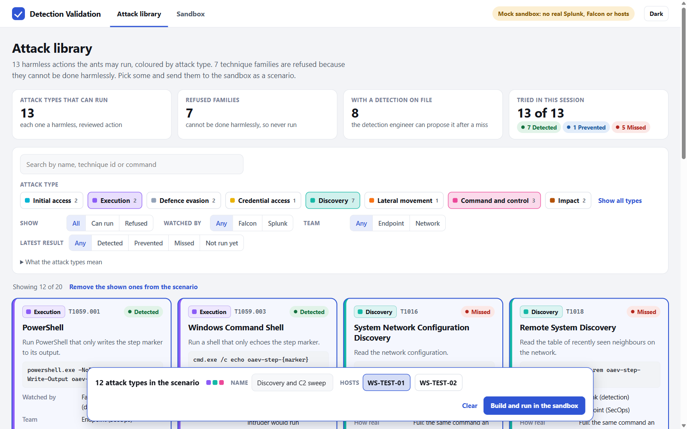
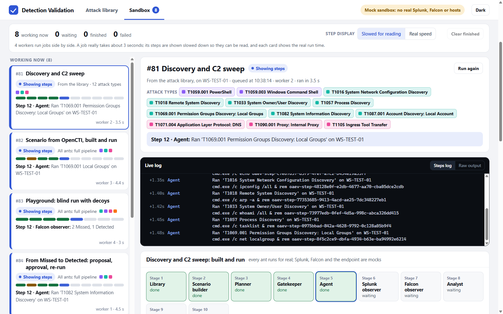
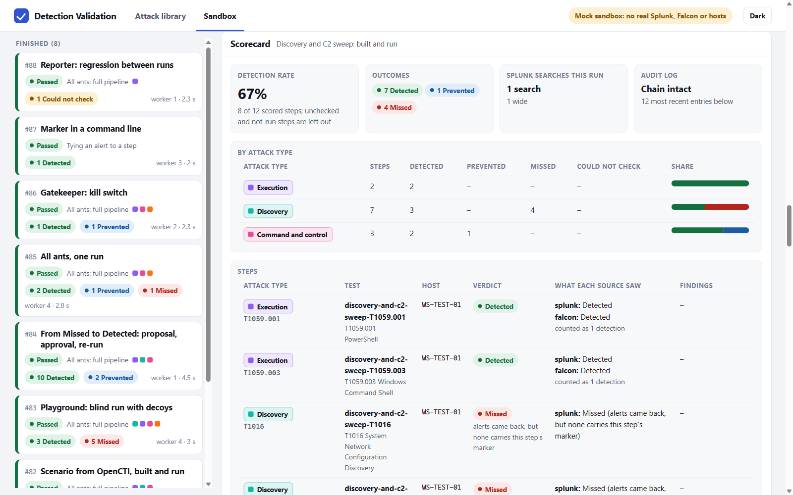
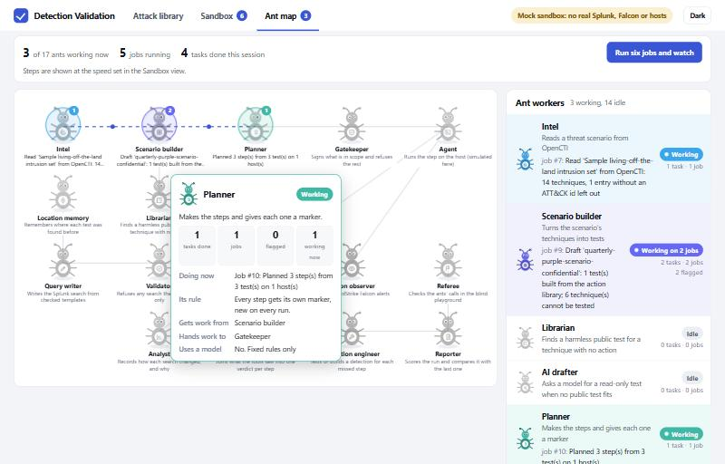

# The front end: attack library, sandbox and ant map

One local web page that shows the ants working. It is a demo and a teaching tool: it runs the same mock scenarios
as the command line and shows each step as it happens. It connects to nothing outside this machine.

| Part | File |
|---|---|
| The page (one file: layout, styles and script) | `splunk-es/harness/demo/index.html` |
| The local server and job queue | `splunk-es/harness/demo_server.py` |

## Start it

```powershell
cd splunk-es
.\.venv\Scripts\python harness\demo_server.py 8140
```

Open <http://127.0.0.1:8140>. The page has three views, chosen with the tabs at the top. It follows the light or
dark setting of the browser.

## View 1: Attack library



Every harmless action the ants may run, and every technique family they refuse, as cards.

- **Colour is the attack type.** Each ATT&CK tactic (discovery, execution, persistence and so on) has its own
  colour, used on the card's edge, its tag and the filter buttons.
- **Filters.** By attack type, by the tool that watches for it (Splunk, Falcon, mail gateway, firewall), by team
  (purple team, SecOps, NetOps), by latest result, and a search box.
- **Refused families** are shown as their own cards with the reason, so it is clear what the ants will not do.
- **Run a pick.** Tick attack types and test hosts, then press Run. The pick goes to the sandbox as a scenario: the
  scenario builder builds the tests, the person who pressed Run is recorded as the approver, and the run goes
  through every ant.

## View 2: Sandbox



A job board. A job is one scenario, running in its own process.

- **Tiles at the top** start the main scenarios with one click: scenario from OpenCTI, all ants, blind playground,
  from Missed to Detected, fill a gap in the library, call the AI drafter, email and firewall tests.
- **All checks** lists every scenario from both suites (28 + 40) to run one by one or all together.
- **Four jobs run at the same time.** The rest wait in a queue. Each job card shows its stage and the step it is on.
- **The open job** shows every step in order, by ant: what came in, what the ant did, what it handed on. Beside it
  is a live log with the real time of each event, and the raw output.
- **Slowed for reading.** A job really takes about three seconds. The page can play its steps back slowly; the real
  run time is on every card.



When a job ends it shows a scorecard: the outcome of each step, the detection rate, the result by attack type, the
findings, the detection proposals, the analyst's search-change log and the gatekeeper's audit log.

## View 3: Ant map



Every ant as a small figure on a map, in the order work passes between them.

- **Each ant has its own avatar**: its own colour and the badge of its job.
- **Grey when idle.** An ant turns to its colour and moves only while it is the one working on a running job. The
  line into it animates, and its current task is written under it.
- **Hover (or tab to) an ant** to see what it does, the rule it never breaks, who it gets work from and hands it
  to, whether it uses a model, what it is doing now or did last, and its numbers for this session: tasks done,
  jobs it took part in, results it flagged, and jobs it is working on now.
- **A panel on the side** lists all seventeen ants with the same state.
- **The AI drafter** is on the map and lights up only when it is called, which is only when the librarian found
  nothing.
- **Run a demo** starts several scenarios at once so the map has something to show.

The seventeen ants and their code are listed in [ANTS.md](ANTS.md).

## How the page gets its data

The page asks the local server; the server runs the scenarios. Nothing else is involved.

| Request | What it does |
|---|---|
| `GET /api/catalogue` | The scenario list, by group |
| `GET /api/library` | The attack library: actions and refused families, by ATT&CK tactic |
| `POST /api/jobs` | Start jobs: `{"ids": [...]}` for scenarios, or `{"custom": {"name", "techniques", "hosts"}}` for a pick from the library |
| `POST /api/poll` | What is new since the page last asked: events and log text per job |
| `POST /api/clear` | Forget the finished jobs |

How a job runs:

1. The server puts the job in a queue. One of four workers takes it.
2. The worker starts the scenario as its own Python process, with its own block of mock ports
   (`18300 + slot x 10`), so jobs cannot disturb each other.
3. The scenario writes one JSON line per event to a file (`HARNESS_EVENTS_STREAM`). Each event names the ant that
   did the work.
4. The server reads that file as it grows; the page polls for what is new and draws it.

A pick from the attack library travels to the scenario in an environment variable (`SANDBOX_CUSTOM`), never on a
command line, and the server checks every technique and host in it against the library first.

## Safety of the page itself

- The server listens on `127.0.0.1` only.
- It answers only requests whose Host header is local, and only JSON posts, so another web page open in the same
  browser cannot drive it.
- It serves one page and five endpoints. It reads no file a request names.
- Job output shown on the page is inserted as text, never as markup.

## Changing the page

| To change | Where in `index.html` |
|---|---|
| An ant on the map: name, colour, badge, position, rule | `ROSTER` |
| The lines between ants | `ANT_EDGES` |
| A badge drawing | `ICONS` |
| The tiles at the top of the sandbox | `FEATURED` |
| Attack-type colours and names | `TACTICS` |
| What an ant's step shows in the open job | `antDetail` |
| The scorecard | `scoreCard` |
| Colours, type sizes, light and dark themes | The `:root` blocks at the top of the `<style>` section |

| To change | Where in `demo_server.py` |
|---|---|
| How many jobs run at once | `SLOTS` |
| The mock port blocks | `MOCK_PORT_BASE` |
| The port of the page | The first argument (default 8140) |

After a change, restart the server and reload the page. The page has no build step: it is one file with no
libraries to install.

## What the page is not

- It is not connected to OpenAEV, to a real Splunk or to Falcon. Every result on it comes from the mock scenarios.
- It is not the product's user interface. OpenAEV has its own. This page exists to see and explain what the ants
  do.
- The "slowed for reading" playback is a display choice. No timing on the page says anything about real search
  speed.
